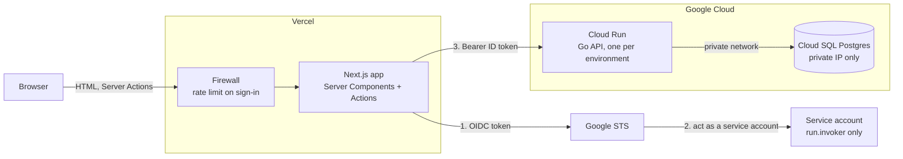

# Scullery

A recipe app used as the customer scenario for a Vercel Solutions Architect exercise. The
customer already runs a Go API and a Postgres database on Google Cloud. Vercel's role is to
**connect**: it hosts the web app and, next, an AI import agent, while the API and the
database stay where they are.

## Architecture



- **The browser never calls the API.** Pages and writes run on the server, so the API address
  and credentials never reach a browser.
- **No stored cloud secret.** A Vercel deployment proves who it is with its OIDC token and gets
  a short-lived Google token for exactly one thing: calling its own API. Preview deployments
  can reach only staging, and only production can reach production.
- **The database has no public address.** It is reached only from Cloud Run over a private network.

## Vercel features in use

| Feature | What it does here |
|---|---|
| Next.js on Vercel with Cache Components | A static shell is served at once and the data streams in. Reads are cached and tagged, and a write refreshes exactly the pages it changed. |
| Server Actions | Create, edit and delete, with the session checked again inside every action |
| OIDC federation | Calls Cloud Run with no stored key ([how](infra/terraform/README.md#how-a-request-from-vercel-is-allowed-in)) |
| Preview deployments | One per pull request, wired to the staging API; its build is a required check |
| Firewall | A rate limit on `POST /login`: 10 attempts per minute per IP, then 429 |
| Web Analytics | Page views, with no cookies |
| Instant rollback | The rollback plan for the web app |
| **Workflow** | The recipe import runs as a durable run: fetch, AI, normalize, each step retried on its own |
| **AI SDK + AI Gateway** | One structured-output call per import, Flash-Lite falling back to Nano, authenticated by OIDC with no key |

### The recipe import

On **New recipe**, paste a link or the recipe text. A Workflow run reads it (the page's
schema.org recipe data if it has some, else its text), asks a model through AI Gateway to fill
the recipe form, and checks the answer against the API's rules and the source itself. The draft
fills the form; **a person always reviews it and saves with the normal Save**. The model has no
tools and the page's text is treated as data, so a page cannot make it do anything but fill the
form. Links are fetched through an SSRF guard (public addresses only).

How good the drafts are is measured, not assumed: an [eval set](apps/web/evals/import/README.md)
of 16 fixed cases, 329 checks, run by hand against each model. Latest: Flash-Lite 325/329 in a
median 1.9 s, Nano 327/329 in 14.4 s. The runs also drove three fixes (see its run log).

## Repository layout

| Path | What it is | Read more |
|---|---|---|
| `apps/web` | The Next.js app (Vercel project root) | [apps/web/README.md](apps/web/README.md): design decisions D1–D6 and known limitations |
| `services/api` | The Go API, its migrations and its container image | [services/api/README.md](services/api/README.md) |
| `infra/terraform` | Google Cloud: network, database, Cloud Run, and the trust Vercel uses | [infra/terraform/README.md](infra/terraform/README.md) |

## Working on it

Tool versions are pinned in [`mise.toml`](mise.toml) (Node 24, Go 1.26, Terraform 1.14,
gitleaks):

```sh
mise install
cd apps/web && npm ci && npm run dev    # see apps/web/README.md for .env.local
make -C services/api verify             # Go checks and tests
```

## Status

Built and deployed: the web app (list, search, favorites, recipe page, create with every field
the API stores, edit, delete, sign-in), the recipe import (Workflow, AI SDK, AI Gateway) and its
eval set, staging and production environments of the API, the sign-in rate limit and Web
Analytics, and CI on every pull request (web, API, secrets and commit-message checks). Still to
come: a visual refresh and the full write-up (rollout plan, success measures, risks).

## Credits

The app icon is the kitchen knife emoji (U+1F52A) from [Twemoji](https://github.com/twitter/twemoji),
Copyright 2020 Twitter, Inc and other contributors, licensed under
[CC-BY 4.0](https://creativecommons.org/licenses/by/4.0/).
