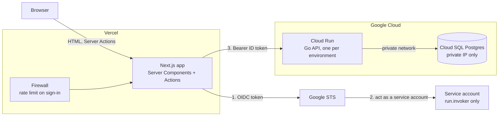

# Scullery

A recipe app used as the customer scenario for a Vercel Solutions Architect exercise. The
customer already runs a Go API and a Postgres database on Google Cloud. Vercel's role is to
**connect**: it hosts the web app and, next, an AI import agent, while the API and the
database stay where they are.

## Architecture



- **The browser never calls the API.** Pages and writes run on the server, so the API address
  and credentials never reach a browser.
- **No stored cloud secret.** A Vercel deployment proves who it is with its OIDC token and gets
  a short-lived Google token for exactly one thing: calling its own API. Preview deployments
  can reach only staging, and only production can reach production.
- **The database has no public address.** It is reached only from Cloud Run over a private network.

## Vercel features in use

| Feature | What it does here |
|---|---|
| Next.js on Vercel with Cache Components | A static shell is served at once and the data streams in. Reads are cached and tagged, and a write refreshes exactly the pages it changed. |
| Server Actions | Create and delete, with the session checked again inside every action |
| OIDC federation | Calls Cloud Run with no stored key ([how](infra/terraform/README.md#how-a-request-from-vercel-is-allowed-in)) |
| Preview deployments | One per pull request, wired to the staging API |
| Firewall | A rate limit on `POST /login`: 10 attempts per minute per IP, then 429 |
| Web Analytics | Page views, with no cookies |
| Instant rollback | The rollback plan for the web app |

**In progress:** a recipe import agent built on the **AI SDK**, **AI Gateway** and **Workflow**.
You paste a link or some text, and the agent fills in the create form for a person to check
before saving. It comes with an evaluation set that measures how accurate the output is.

## Repository layout

| Path | What it is | Read more |
|---|---|---|
| `apps/web` | The Next.js app (Vercel project root) | [apps/web/README.md](apps/web/README.md): design decisions D1–D6 and known limitations |
| `services/api` | The Go API, its migrations and its container image | [services/api/README.md](services/api/README.md) |
| `infra/terraform` | Google Cloud: network, database, Cloud Run, and the trust Vercel uses | [infra/terraform/README.md](infra/terraform/README.md) |

## Working on it

Tool versions are pinned in [`mise.toml`](mise.toml) (Node 24, Go 1.26, Terraform 1.14,
gitleaks):

```sh
mise install
cd apps/web && npm ci && npm run dev    # see apps/web/README.md for .env.local
make -C services/api verify             # Go checks and tests
```

## Status

Built and deployed: the web app (list, search, favorites, recipe page, create, delete,
sign-in), staging and production environments of the API, the sign-in rate limit and Web
Analytics. Still to come: the AI import agent and its evals, editing recipes, a visual
refresh, CI, and the full write-up (rollout plan, success measures, risks).
