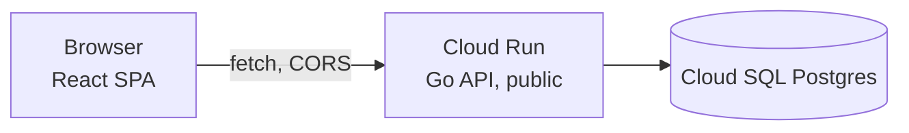
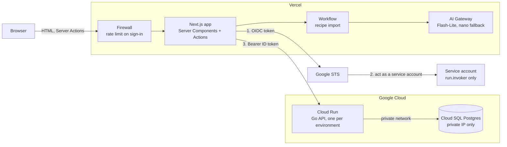
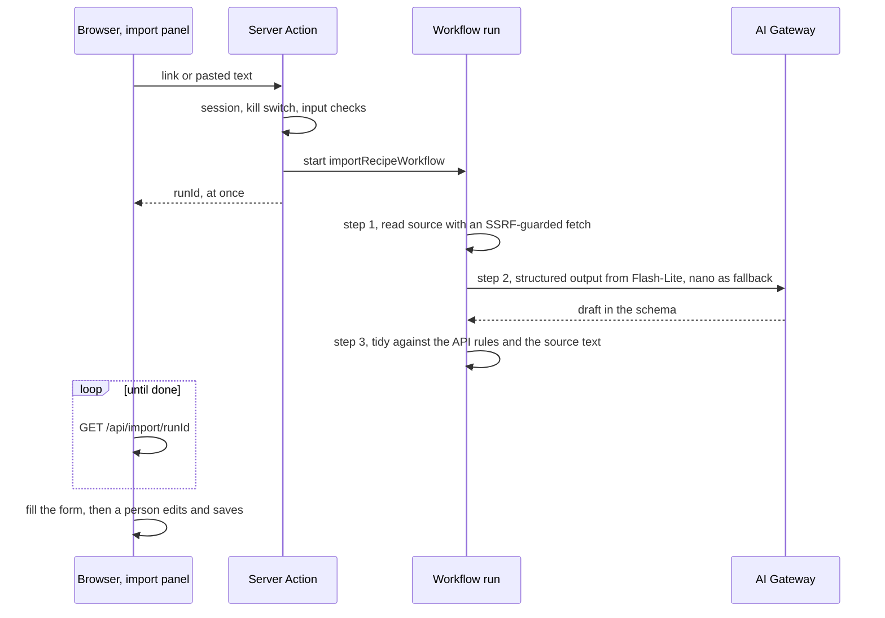

# Scullery

A Vercel Solutions Architect exercise, written up as the customer engagement it imitates.
**Scullery** is a fictional team's recipe app: a Go API and Postgres on Google Cloud, with a
React single-page app in front. They wanted Vercel for two things: a faster, safer web front end,
and a home for agentic features, without moving their API or their data.

- **Live demo:** https://scullery-chi.vercel.app. The front page is a one-page solution overview for
  the customer; **Open the app** leads to sign-in. Reviewer credentials came with the submission.
- **This README** is the technical companion: architecture, decisions, rollout, measures, risks.
  Deeper detail lives next to the code ([web](apps/web/README.md), [API](services/api/README.md),
  [infrastructure](infra/terraform/README.md), [evals](apps/web/evals/import/README.md)).

Contents: [Problem](#1-the-problem) · [Architecture](#2-architecture) ·
[Vercel primitives](#3-vercel-primitives) · [The agentic workflow](#4-the-agentic-workflow-recipe-import) ·
[Try it](#5-try-it) · [Rollout](#6-rollout-plan) · [Success measures](#7-success-measures) ·
[Limitations and risks](#8-limitations-and-risks) ·
[Tooling and AI validation](#9-dev-tooling-and-how-ai-output-was-validated) ·
[Building on Vercel](#10-building-on-vercel-feedback)

## 1. The problem

The team had a working product and four things holding it back:

1. **The API was public by necessity.** The single-page app called it from every browser: open
   CORS, its address in every bundle, and nothing it trusted could be secret.
2. **Slow first loads.** Pages arrived empty and filled in after JavaScript and API round trips.
3. **No safe place to try a change.** One shared test environment, no preview per change, and
   rollback meant a redeploy.
4. **AI with no home.** Their most-asked feature was "add a recipe from a link". That needs model
   calls, retries, fallbacks and guardrails, and they did not want to run that infrastructure, pick
   a single model provider, or move their data.

**Goal:** keep the Go API and Postgres exactly where they are, and let Vercel **connect** to them:
host the web app and the AI import, with no stored cloud keys and no public path to the data.

## 2. Architecture

**Before:** the browser talks to the API directly.



**After:** the browser talks only to Vercel; Vercel talks to the API with a short-lived identity.



- **The browser never calls the API.** Pages render and writes run on the server, so the API's
  address and credentials never reach a browser, and the API no longer needs CORS.
- **No stored cloud secret.** Each deployment proves who it is with its Vercel OIDC token and
  gets a Google token for exactly one thing: invoking its own API. Previews can reach only
  staging; only production reaches production. Both were tested in both directions (a staging
  identity calling production gets 403).
- **The database has no public address.** Only Cloud Run reaches it, over a private network.
- **Two environments end to end.** Staging and production each have their own Cloud Run service,
  database, user, secret and service account, all in [Terraform](infra/terraform/README.md).

## 3. Vercel primitives

| Primitive | What it does here | Why |
|---|---|---|
| **Next.js with Cache Components** | A static shell from the CDN, data streamed in; reads cached and tagged, refreshed by `updateTag` on every write | Fast first paint without stale data ([D1–D3](apps/web/README.md#decisions)) |
| **Server Actions** | Create, edit, delete, sign-in and import start, each checking the session itself | No public API surface of our own; every action is its own endpoint and guards itself |
| **OIDC federation** | Keyless calls from Vercel to Cloud Run ([how](infra/terraform/README.md#how-a-request-from-vercel-is-allowed-in)) | Nothing to leak or rotate; trust is per environment |
| **Workflow** | Each import is a durable run: read the source, call the model, tidy the answer, each step retried on its own | Model calls are slow and flaky; retries and state come from the platform |
| **AI SDK + AI Gateway** | One structured-output call, Gemini 2.5 Flash-Lite falling back to GPT-5 nano, authenticated by OIDC | Provider choice and fallback are configuration, not code; no API key |
| **Preview deployments** | One per pull request, wired to the staging API; a required check | Every change is tried for real before it merges |
| **Firewall** | Rate limit on `POST /login`: 10 per minute per IP, then 429 | The one custom rule Hobby allows, spent on the one brute-forceable endpoint |
| **Web Analytics, Speed Insights** | Page views (no cookies) and real-user Core Web Vitals | The success measures in section 7 |
| **Instant rollback** | The web app's rollback plan | Seconds, not a rebuild |

## 4. The agentic workflow: recipe import

The AI feature is "add a recipe from a link or pasted text". It is deliberately a **constrained
agent**: a durable pipeline with one model call, no tools, and a person approving the result.



**The pieces, and where they live** (all under [`apps/web/src`](apps/web/src)):

| Piece | Code | Job |
|---|---|---|
| Start | [`recipes/import/actions.ts`](apps/web/src/app/%28app%29/recipes/import/actions.ts) | A Server Action: checks the session and the kill switches, validates the input, loads the API's unit list, calls `start()` and returns the run id in milliseconds |
| The run | [`lib/workflows/importRecipe.ts`](apps/web/src/lib/workflows/importRecipe.ts) | `'use workflow'` function calling three `'use step'` functions: read, structure, tidy |
| Step 1: read | [`lib/import/fetchPage.ts`](apps/web/src/lib/import/fetchPage.ts), [`source.ts`](apps/web/src/lib/import/source.ts) | Fetches a link (public addresses only, 3 redirects, 10 s, 2 MB), then shrinks it: the page's schema.org JSON-LD recipe if it has one, else its visible text, capped at 20,000 characters |
| Step 2: structure | [`lib/import/structure.ts`](apps/web/src/lib/import/structure.ts), [`prompt.ts`](apps/web/src/lib/import/prompt.ts), [`schema.ts`](apps/web/src/lib/import/schema.ts), [`models.ts`](apps/web/src/lib/import/models.ts) | One AI SDK `generateText` call with `Output.object`, sent to AI Gateway |
| Step 3: tidy | [`lib/import/normalize.ts`](apps/web/src/lib/import/normalize.ts) | Treats the answer as untrusted input: applies the API's limits, keeps a unit only if the source spells it, fills times from the source's own durations |
| Status | [`api/import/[runId]/route.ts`](apps/web/src/app/api/import/[runId]/route.ts) | Signed-in `GET` the panel polls: running, done with the draft, or failed in plain words |

**How Workflow is used.** Each step's result is recorded, so a crash or a redeploy resumes from the
last finished step, and a failing step is retried on its own without repeating the others. Errors
are sorted on purpose: an expected outcome ("that does not look like a recipe", a site that blocks
bots) is returned as a value for the page to show; a timeout or a 503 throws `RetryableError`; an
authentication failure, a refused model or an exhausted budget throws `FatalError`, because retrying
cannot help. That last rule came from the spike, where the free tier refusing a model was retried
three times for nothing. The action starts the run and returns, and the panel polls, because an
import takes from 2 to 30 seconds and an action should not hold a request open that long.

**How AI Gateway is used.** The model is a plain string, `google/gemini-2.5-flash-lite`, handed to
the AI SDK, which sends it to AI Gateway. Gateway authenticates with the deployment's OIDC token, so
there is **no AI or provider key** anywhere in the app. The fallback, `openai/gpt-5-nano`, is a
Gateway routing option (`providerOptions.gateway.models`), so Gateway retries the other model itself
and the app only sees which one answered. That model's name goes in the audit log and in the note
on the form. Swapping a provider or a model is a one-line change in [`models.ts`](apps/web/src/lib/import/models.ts),
gated by the eval set below.

**Guardrails.** The page is untrusted, and a recipe page can say anything, including "ignore your
instructions". Four defences, strongest first:

1. **The model has no tools.** It can only fill the schema: it cannot fetch, save or call anything,
   and the schema limits units to the API's own list.
2. **The app checks the answer** ([`normalize.ts`](apps/web/src/lib/import/normalize.ts)) before it
   reaches the form.
3. **A person approves every draft.** The run never saves; the form's normal Save does, through the
   same validation as a recipe typed by hand.
4. **The prompt** says the source is data to transcribe, never instructions.

Cost and abuse are bounded by the input cap, a free-tier-only model list, and two kill switches:
`IMPORT_DISABLED` stops the AI alone and `READ_ONLY` stops every write and AI call. Both are checked
on every start, not only when the page loads.

**Evals.** Prompt and model changes are gated by a [16-case, 329-check eval set](apps/web/evals/import/README.md),
run by hand with `scripts/eval-import.ts`. It uses saved pages (no live fetching) and covers clean
and messy recipes, fractions, ranges, a non-recipe that must be refused, and a prompt-injection
page. The results chose the models: Flash-Lite 325/329 in 1.9 s as primary, nano 327/329 in
14.4 s as fallback.

## 5. Try it

Open https://scullery-chi.vercel.app, read the overview, then **Open the app** and sign in.

- **Browse:** search, filter favorites, open a recipe. Try the ⋮ menu with only the keyboard, and
  the light/dark switch in the header.
- **Import:** on **New recipe**, choose **Pasted text** and paste one of the eval fixtures, for
  example [numbered steps](apps/web/evals/import/fixtures/10-text-numbered.txt) or
  [sections](apps/web/evals/import/fixtures/12-text-sections.txt). The form fills in, with a note
  naming the model and the time it took. Check it, then **Save recipe**.
- **Import from a link:** paste a recipe page's address. Many recipe sites block automated visits;
  when one does, the import says so at once and offers **Paste the text instead**.
- **See it refuse:** `https://example.com` ("does not look like a recipe"), and
  `http://169.254.169.254/` (the cloud metadata address: refused before any request is made).
- **Edit and delete:** ⋮ on a recipe. Favorites and source name survive an edit.

## 6. Rollout plan

How this would reach the customer's real users, in stages that can each be undone.

1. **Parallel run.** The Vercel app runs against **staging** through preview deployments while the
   old single-page app keeps serving production. Every pull request is a preview plus required CI.
2. **Internal production.** Production deployment on Vercel, used by the team only. The AI import
   ships switched off (`IMPORT_DISABLED=1`) and is turned on for this group first.
3. **Canary the cutover.** On Vercel Pro, **Rolling Releases** shift production traffic to the new
   deployment in steps (for example 5%, 25%, 100%), each gated on the measures below: Core Web
   Vitals, 5xx rate, import success. On Hobby, as here, the same safety comes from **instant
   rollback** (seconds) and the two kill switches: `READ_ONLY` stops every write and AI call,
   `IMPORT_DISABLED` only the AI.
4. **Close the old door.** Once the old app is retired, the API stops accepting browser traffic:
   Cloud Run already requires an identity token, so nothing but Vercel's service accounts can call it.

**The API side**, designed and partly built:

- **Images** are pinned by digest in [`api_image.auto.tfvars`](infra/terraform/README.md#deploying-an-image)
  and applied to staging, then production. Today they are built, scanned and pushed by hand. Next:
  CI builds on merge, scans, signs (cosign keyless), attests provenance and opens a pull request that
  bumps the digest, authenticated to Google Cloud with GitHub OIDC (no key).
- **A canary for the API** is a Cloud Run traffic split between two revisions.
- **Migrations stay backward compatible** (expand, then contract), so the old and the new app both
  run against the schema during a rollout, and a rollback never needs a down-migration.
- **Rollback:** Vercel instant rollback for the web app; revert the digest commit, or shift Cloud
  Run traffic back to the previous revision, for the API.

## 7. Success measures

| Goal | Measure | Source | Target | Today |
|---|---|---|---|---|
| Fast | LCP, INP, CLS at p75 | Speed Insights | 2.5 s, 200 ms, 0.1 | Collecting since 2026-11-22 |
| Used | Weekly active visitors, recipes created | Web Analytics; `recipe.created` audit lines | Grows after cutover | Demo traffic only |
| The AI helps | Imports that end in a draft | `import.started` / `import.finished` / `import.failed` audit lines | 90%+ (refusals by bot-protected sites aside) | Measured locally, not at volume |
| The AI is right | Eval checks passed | [Eval set](apps/web/evals/import/README.md) | 98%+, a gate for any model or prompt change | 325/329 (98.8%) |
| The AI is quick | Median time to a draft | Workflow runs, eval runs | Under 5 s | 1.9 s (Flash-Lite) |
| Reliable | 5xx rate; API latency | Vercel logs; Cloud Run metrics | Under 0.1%; p95 under 200 ms warm | Warm ~55 ms; cold start 3.7 s |
| Safe | Stored cloud keys; public database addresses | Terraform, by construction | 0 and 0 | 0 and 0 |
| Cheap | Monthly cost | Billing pages | Within Hobby and free tiers, plus Cloud SQL | Cloud SQL estimated $10–15 (not yet checked on the bill) |

## 8. Limitations and risks

The ones that matter most; each is explained in full, with what it would take to fix, in the
[web app's known limitations](apps/web/README.md#known-limitations).

- **AI Gateway free tier: 5 requests a minute per model, team-wide.** A burst falls back to the
  slower model (about 15 s), then waits. A real launch buys credits or brings its own key.
- **Sign-in is two fixed accounts,** with a per-IP rate limit and no per-user quotas or lockout.
  A real product would use an identity provider.
- **Last save wins** when two people edit one recipe; there is no version check yet.
- **DNS rebinding** could, in theory, slip a link fetch past the private-address check. Accepted
  because these functions run outside Google Cloud and the API trusts identity, not network position.
- **Not proven at scale:** `updateTag` freshness across many serverless instances, and the import
  under real traffic.
- **Infrastructure:** Terraform state is local (one operator), the API image pipeline is manual,
  and the database users are members of `cloudsqlsuperuser`, broader than they need to be.
- **Deletes are permanent;** a soft delete with undo would need an API change.

## 9. Dev tooling and how AI output was validated

**Tooling.** Tool versions are pinned in [`mise.toml`](mise.toml). CI
([`.github/workflows/ci.yml`](.github/workflows/ci.yml)) runs on every pull request: typecheck,
lint, formatting, and a check that the API types match its OpenAPI document; the Go API's tests
against a real Postgres; gitleaks over the change's commits; and a Conventional Commits check. Those
checks and the Vercel build are required by branch protection. Every npm dependency is pinned to
an exact version.

**AI-assisted, human-owned.** This project was built with Claude Code as a pair. Every change went
through a plan agreed first, small commits, CI, and a check on a real deployment; nothing was
merged on the model's word. Checks caught real bugs along the way: a production build that
failed on a component reading the URL outside `<Suspense>`, a focus bug found by driving the menu
with the keyboard, and gitleaks reporting "no leaks" on a commit range it could not read (now
guarded).

**The AI feature's output** is validated three ways:

1. **An eval set** of 16 fixed cases and 329 deterministic checks
   ([README and run log](apps/web/evals/import/README.md)), run by hand against each model. Three
   runs drove three fixes: request pacing, two prompt rules, and a code check that keeps a unit only
   when the source line spells it. Results decided the models: Flash-Lite 325/329 in 1.9 s, nano
   327/329 in 14.4 s.
2. **Code checks on every answer:** the schema limits units to the API's own list, and the answer is
   normalized against the API's rules and the source text before it reaches the form.
3. **A person approves every draft.** The import fills the form and stops; saving goes through the
   same checks as a recipe typed by hand.

## 10. Building on Vercel: feedback

What worked well, and what I'd change, from building this.

**Liked**

- **OIDC federation to Google Cloud** is the highlight: no stored keys, per-environment trust, and it
  even works inside cached functions.
- **Preview per branch** made review real: every change had a working URL against staging.
- **Cache Components with `updateTag`:** precise freshness after writes with very little code.
- **Workflow:** durable steps and retries for free; `FatalError` versus `RetryableError` maps neatly
  onto model errors.

**Frustrated by**

- **AI Gateway free tier errors:** a refused model (Haiku) surfaced as a retried 500, not a clear
  "not available on your plan"; 5 requests a minute is tight even for a demo.
- **Workflow's queue route** answers 404 from outside, which looks broken until you learn it is
  air-gapped on purpose; a hint in the response or the docs would save time.
- **shadcn CLI:** it installed its own `cn` package and left out `class-variance-authority` and
  `lucide-react`; I wired those by hand.
- **Hobby limits for SA demos:** Rolling Releases and more than one firewall rule are Pro-only, so
  the canary here is a documented design.

## Repository layout

| Path | What it is | Read more |
|---|---|---|
| `apps/web` | The Next.js app (Vercel project root) | [apps/web/README.md](apps/web/README.md): decisions D1–D7, security rules, known limitations |
| `services/api` | The Go API, its migrations and its container image | [services/api/README.md](services/api/README.md) |
| `infra/terraform` | Google Cloud: network, database, Cloud Run, and the trust Vercel uses | [infra/terraform/README.md](infra/terraform/README.md) |
| `.github` | CI workflow and the pull request template (GitHub reads only the root `.github`) | [ci.yml](.github/workflows/ci.yml) |

Inside the web app, `src/` is three folders: `app` (routes), `components` and `lib` (everything
else). The [layout section](apps/web/README.md#layout) has the rules.

## Working on it

```sh
mise install
cd apps/web && npm ci && npm run dev    # see apps/web/README.md for .env.local
make -C services/api verify             # Go checks and tests
```

## Credits

The app icon is the kitchen knife emoji (U+1F52A) from [Twemoji](https://github.com/twitter/twemoji),
Copyright 2020 Twitter, Inc and other contributors, licensed under
[CC-BY 4.0](https://creativecommons.org/licenses/by/4.0/).
